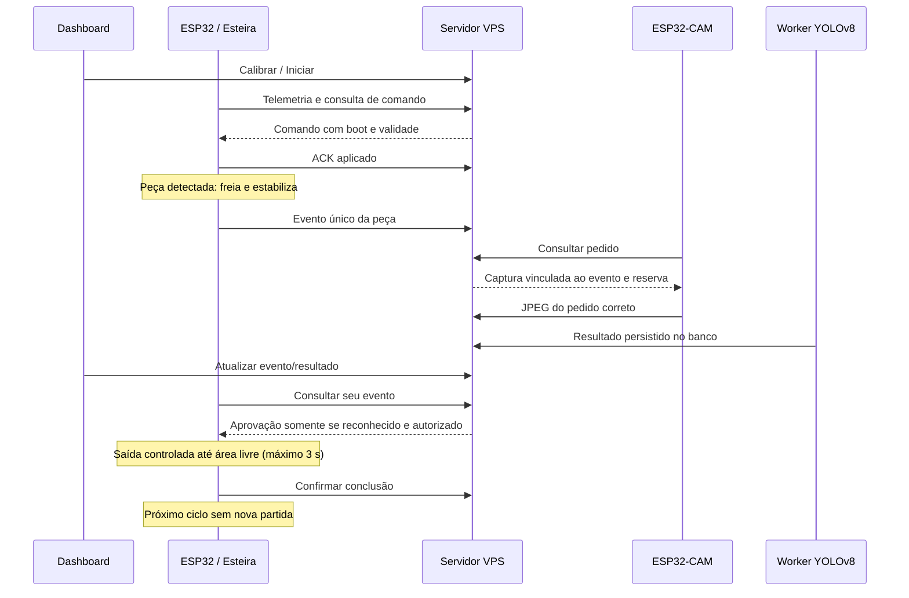

# Versão 3 — esteira, ESP32-CAM, YOLOv8 e dashboard

Data: 08/11/2026. Base: motor Teste 5 e site da Versão 2. Câmera confirmada: AI Thinker com OV2640 e PSRAM.

## Arquivos atuais

| Parte | Documento e código |
|---|---|
| ESP32 da esteira | [motor/README.md](motor/README.md) e [esteira-v3.ino](motor/esteira-v3/esteira-v3.ino) |
| ESP32-CAM | [camera/README.md](camera/README.md) e [esp32cam-v3.ino](camera/esp32cam-v3/esp32cam-v3.ino) |
| Site/API/worker | [site/README.md](site/README.md) |
| Modelo e classes | [site/models/README.md](site/models/README.md) |
| Comunicação entre partes | [conexoes-esp32/README.md](conexoes-esp32/README.md) |
| Instalação/atualização | [guia da VPS](site/docs/01_INSTALACAO_VPS.md) |
| Testes e limites | [VALIDACAO.md](VALIDACAO.md) |

O Teste Motor 5 também acompanha a pasta motor como referência copiada da versão anterior; o firmware a gravar nesta versão é **esteira-v3**. Não misturar firmwares de versões anteriores com este protocolo.

## Ciclo implementado

**Esperar cinco segundos não libera mais o motor.** A liberação pertence ao mesmo evento/boot que originou a captura. Desconhecido, erro, timeout, reinício ou autorização revogada mantêm a parada. A peça aprovada pode ser movimentada mesmo ocupando o sensor, para sair da região; o movimento tem prazo e confirmação de área livre.

## Botões

- **Calibrar:** esvaziar a esteira e aguardar confirmação aplicada pela placa.
- **Iniciar:** autorizar a sessão atual quando sensor, calibração, câmera e YOLO estiverem prontos. Os ciclos seguintes são automáticos após reconhecimento.
- **Parar:** revogar autorização, parar e impedir liberação por resultado atrasado.

Pedido enviado não é comando confirmado. O painel distingue cada estágio e exibe telemetria recente, estado da câmera/worker e motivo de rejeição. Motor reportado é saída GPIO, não medição por encoder.

## Configuração necessária

1. Configurar `.env` do servidor, modelo `best.pt` e mapa `classes.json` com IDs ativos do catálogo.
2. Executar `db`, `app` e `worker` na VPS conforme o guia, preservando volumes e nome do projeto Compose existente.
3. Criar `config.h` local em cada sketch a partir do respectivo `config.example.h`: Wi-Fi, URL, token do papel e CA.
4. Gravar os firmwares e confirmar a comunicação. Não há credenciais reais nesta entrega.
5. Retirar peças, Calibrar e Iniciar. Para desconhecido/erro: Parar, remover a peça, Calibrar e Iniciar novamente.

YOLOv8 precisa ser treinado com suas peças. Fotos cadastradas no site não treinam automaticamente esse modelo. O worker não baixa um modelo genérico para aprovar módulos; sem pesos/mapa válidos, informa erro e bloqueia a partida. O arquivo treinado e as características da VPS ainda não foram fornecidos/confirmados.

## Segurança local e pendências elétricas

A esteira inicia sem autorização e requer nova liberação após reinício/falha. O sensor continua sendo monitorado numa tarefa independente das chamadas de rede. Perda de contato por 3 s, sensor inválido ou análise acima do prazo levam à parada; reconectar não inicia sozinho. Calibração não aprova ou cancela antecipadamente uma análise pendente.

Pinagem do motor e ultrassônico está no README do motor. O último relato manteve a bateria de 8–8,4 V em VM apesar do motor informado como 5 V: adequar antes de energizar a 100%. Instalação do divisor ECHO e emergência física também seguem pendentes de confirmação. O botão do site não substitui emergência física.

## Entregue e validado

- Implementados os dois firmwares, comandos, fila de captura, worker YOLOv8, aprovação vinculada, saída controlada, migração e interface.
- Ambos os firmwares compilados; 27 testes Python e 2 scripts de UI passaram, com banco PostgreSQL local real nos testes de integração.
- Sem implantação na VPS, gravação de placas ou validação física. Sem inferência/precisão real sem os pesos do usuário.

Os testes e a compilação não comprovam o funcionamento do conjunto montado. Evidências e próximos ensaios estão em VALIDACAO.md. A próxima alteração de código deverá criar a Versão 4; a Versão 3 será preservada.
